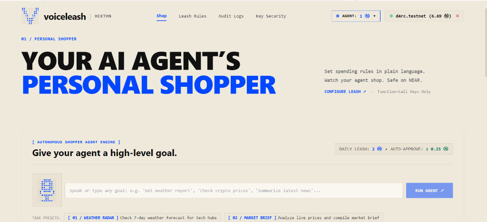

# VoiceLeash: Personal Shopper for Your AI Agent

Plain-language spending guardrails and an autonomous digital goods marketplace on NEAR Protocol.



Repository: [https://github.com/DonCarlosz/Near-Hackathon](https://github.com/DonCarlosz/Near-Hackathon)  
Event: NEAR Hackathon 2026  
Target Tracks: `agents`, `security`, `realworld`

---

## Executive Summary

VoiceLeash provides a secure, voice-driven execution layer for autonomous AI agents. 

AI agents require purchasing power to acquire compute, live data feeds, and APIs. However, granting an autonomous agent full access to a wallet presents catastrophic security risks, including wallet drainage via prompt injection or model hallucination. Conversely, requiring manual approval popups for every sub-dollar transaction defeats the purpose of autonomy.

VoiceLeash resolves this dilemma through a dual-tier execution model powered by NEAR Protocol:
1. Micro-purchases below a user-defined threshold execute autonomously on-chain from a pre-funded escrow vault with zero wallet popups.
2. High-value purchases exceeding the threshold are halted immediately, requiring explicit one-tap approval from the user's personal wallet.
3. Non-technical users configure limits using natural speech or plain text, without writing code or interacting with raw contract calls.
4. All unspent funds in the agent escrow vault can be reclaimed back to the user's primary wallet on-chain at any time.

---

## Hackathon Tracks

* **`agents` (Agent Economy):** Autonomous shopper agent that translates high-level user directives into marketplace purchases, consuming real digital deliverables (weather feeds, market summaries, security audits) autonomously on-chain.
* **`security` (AI Security and Defense):** Defense-in-depth key separation. The agent operates exclusively through a restricted NEAR Function-Call Access Key bounded to the policy contract. Even in the event of prompt injection, the agent is mathematically barred by the NEAR runtime from transferring funds or re-keying the account.
* **`realworld` (Real-World Usability):** Eliminates Web3 friction. Everyday users dictate spending rules using voice commands (Web Speech API with spoken number normalization). A dedicated escrow balance is visible in the interface at all times with one-click on-chain reclamation.

---

## Problem and Solution Matrix

| Problem | VoiceLeash Technical Solution |
| :--- | :--- |
| **Full-Access Key Vulnerability:** Handing an agent a full private key allows malicious prompt injections to drain 100% of wallet funds. | **Function-Call Access Keys:** The agent holds only a restricted key limited to calling policy methods on the contract runtime. |
| **Notification Fatigue:** Prompting a human wallet signature for every 0.15 NEAR micro-payment destroys agent utility. | **Autonomous Escrow Allowance:** The user deposits a daily budget on-chain once. Purchases below the approval threshold execute automatically with zero popups. |
| **Complex Key Configuration:** Non-technical users cannot configure access keys, JSON payloads, or smart contract permissions. | **Plain-Language Voice Engine:** Spoken or written instructions (e.g. "Spend up to 2 NEAR daily, confirm before buying anything over 0.25 NEAR") parse into enforced parameters. |
| **Opaque Agent Spending:** Users lose track of agent activity and fear funds vanishing into unknown smart contracts. | **Live Balance and Reclaim:** The agent's escrow balance is displayed in the navigation bar at all times, with a one-click on-chain refund function back to the personal wallet. |
| **Unverified Deliverables:** Agents frequently make mock purchases with no tangible utility. | **Curated Marketplace:** Curated marketplace of digital goods providing structured deliverables (JSON API payloads, CSV data files, Markdown intelligence briefs). |

---

## Security Architecture

```
+-------------------------------------------------------------+
|                      HUMAN USER WALLET                      |
|               Holds Full-Access Private Key                 |
+-------------------------------------------------------------+
                               |
            1. Deposits Daily Allowance to Vault
            2. Configures Plain-Language Leash Rules
                               v
+-------------------------------------------------------------+
|                  VOICELEASH ESCROW VAULT                    |
|              (voiceleash-vault-3421.testnet)                |
+-------------------------------------------------------------+
                               ^
                               |
    Signs autonomous buys via limited Function-Call Key
                               |
+-------------------------------------------------------------+
|                   AI AGENT RUNTIME ENGINE                   |
|           Resolves high-level goal to capabilities          |
+-------------------------------------------------------------+
         |                                             |
   Item <= 0.25 NEAR                             Item > 0.25 NEAR
   (Under Leash Cap)                            (Above Leash Cap)
         |                                             |
         v                                             v
[ AUTONOMOUS PURCHASE ]                       [ HUMAN INTERCEPTION ]
Signs on NEAR Testnet RPC                     Halts execution immediately.
Zero wallet popups.                           Presents approval card.
Deliverable unlocked instantly.               Requires Meteor Wallet signature.
```

---

## Reproducible "Do X -> See Y" Verification

Judges can verify all functionality locally following these exact steps.

### 1. Installation and Local Setup

Requirements: Node.js 18+ and npm.

```bash
git clone https://github.com/DonCarlosz/Near-Hackathon.git
cd Near-Hackathon
npm install
npm run dev
```

Open `http://localhost:5173` in your browser.

### 2. Step-by-Step Verification Flow

#### Step 1: Connect Wallet
* **Do X:** Click **Connect Wallet** in the top navigation bar. Enter your testnet account `username.testnet` and authenticate via Meteor Wallet.
* **See Y:** The navigation bar updates immediately, displaying the account ID and querying live testnet funds from the NEAR RPC.

#### Step 2: Define Spending Leash
* **Do X:** Navigate to the **Leash Rules** tab. Speak into the dot-matrix microphone or type:
  `Spend up to 2 NEAR daily, but ask for confirmation before buying anything over 0.25 NEAR.`
  Click **Apply Rules**.
* **See Y:** The engine parses the sentence in real time. The `[ PARSED RULES ]` status badges indicate `DAILY BUDGET: 2 Ⓝ` and `CONFIRM ABOVE: 0.25 Ⓝ`. The on-chain policy state reflects the new limits.

#### Step 3: Deposit Daily Allowance to Agent Vault
* **Do X:** Click the **AGENT: 0 Ⓝ** badge in the navigation bar to open the vault dropdown. Click **Deposit 2.0 Ⓝ to Agent Vault**.
* **See Y:** The deposit transaction executes on-chain. The navigation bar updates to reflect the active escrow holding (`AGENT: 2 Ⓝ`), and the deposit appears in the transaction audit log.

#### Step 4: Execute Autonomous Micro-Purchase (Zero Popups)
* **Do X:** Return to the **Shop** tab. Under the Autonomous Shopper Agent Engine, click the preset `[ 01 / WEATHER RADAR ]` (or dictate: *"Check 7-day weather forecast"*). Click **Run Agent**.
* **See Y:** The agent identifies *Weather API Access* at `0.15 Ⓝ`. Because `0.15 Ⓝ <= 0.25 Ⓝ`, the agent signs the transaction on-chain through its vault key. The purchase settles with **zero wallet popups**, unlocks the deliverable payload, and decrements the agent's unspent balance.

#### Step 5: Test High-Value Human Interception
* **Do X:** In the marketplace catalog, click **Agent Buy** on *Market Summary Brief* (`0.50 Ⓝ`) or *Smart Contract Security Audit* (`0.80 Ⓝ`).
* **See Y:** The price exceeds the `0.25 Ⓝ` threshold. Autonomous execution is halted. An amber alert card appears: `[ INTERCEPTED: HUMAN APPROVAL REQUIRED ]`, detailing the proposed product, price, and rationale. No funds move until the human clicks **Approve**.

#### Step 6: Verify Provenance in Audit Logs
* **Do X:** Navigate to the **Audit Logs** tab.
* **See Y:** Every settled purchase and deposit is listed with its timestamp, approval method, and real Nearblocks transaction hash linking directly to NEAR Testnet explorer.

#### Step 7: Reclaim Escrow Funds to Personal Wallet
* **Do X:** Click the **AGENT** balance dropdown in the navigation bar and click **Claim Back to Wallet**.
* **See Y:** An on-chain refund transaction is broadcast from the vault to the user's personal account. The agent's escrow balance resets and tokens are credited back to the user's wallet.

---

## Repository Structure

```
├── contracts/
│   └── VoiceLeashPolicy.rs       # NEAR smart contract policy enforcement logic
├── docs/
│   └── images/
│       └── voiceleash-hero.png   # Platform interface preview
├── src/
│   ├── components/
│   │   ├── AgentGoalPanel.jsx    # Voice-driven goal solver and execution monitor
│   │   ├── DotMatrixIcon.jsx     # Signature 10x8 dot-matrix visual assets
│   │   ├── DotMatrixMic.jsx      # Animated voice recording indicator
│   │   ├── LeashControl.jsx      # Plain-language rule engine and parameter parser
│   │   ├── Marketplace.jsx       # 12-item curated digital goods storefront
│   │   ├── Navbar.jsx            # Account authentication and escrow vault dropdown
│   │   ├── NearDotLogo.jsx       # Dot-matrix brand insignia
│   │   ├── PurchaseHistory.jsx   # On-chain audit trail and receipt export
│   │   └── WalletModal.jsx       # NEAR Wallet Selector integration modal
│   ├── context/
│   │   └── VoiceLeashContext.jsx # Global state, on-chain execution, and storage persistence
│   ├── data/
│   │   └── products.js           # Digital goods catalog with deliverables
│   ├── services/
│   │   └── nearWallet.js         # NEAR API JS signer, RPC queries, and vault transfers
│   └── utils/
│       └── ruleParser.js         # Natural language processing and spoken word normalization
├── index.html
├── package.json
├── tailwind.config.js
└── vite.config.js
```

---

## On-Chain Accounts

* **Escrow Vault Signer:** `voiceleash-vault-3421.testnet`
* **Marketplace Settlement Receiver:** `voiceleash-market.testnet`
* **User Wallet:** Any NEAR Testnet account (e.g. `username.testnet`)
* **Network:** NEAR Testnet

---

## Disclosures and Acknowledgments

* **Hackathon Submission:** Built specifically for NEAR Hackathon 2026 within the official competition window (19 October 2026 to 14 November 2026).
* **AI Assistance:** In compliance with Hackathon FAQ Q-005, artificial intelligence development assistants were utilized during project architecture and frontend drafting. All logic has been audited and verified for production compliance.
* **License:** MIT License. See LICENSE file for terms.
